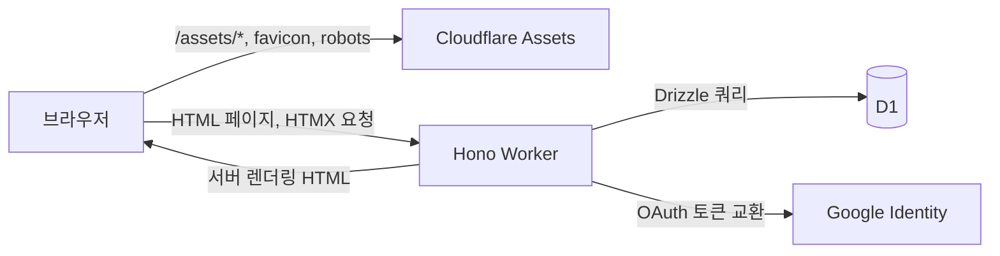

# 01. 아키텍처

## 한눈에 보기



- 정적 파일은 Cloudflare Assets가 먼저 처리합니다.
- HTML 라우트와 HTMX 요청은 Hono Worker가 처리합니다.
- DB는 D1 바인딩 `DB`로 접근하고, SQL은 Drizzle이 생성합니다.
- 로그인만 Google과 통신하며, 이후 요청은 서명 쿠키로 인증합니다.

## 요청 흐름

### 1. 페이지 최초 진입

```text
GET /volunteers
  → Cloudflare Assets에 경로 없음
  → Hono Worker
  → logger
  → secureHeaders
  → requireAuth: 세션 쿠키 검증
  → listVolunteers + countVolunteers (D1)
  → Layout + VolunteersView JSX 렌더링
  → 200 text/html
```

### 2. HTMX 부분 갱신

```text
GET /volunteers/table?q=김&status=active
  → requireAuth
  → 필터 파싱
  → 목록 + 건수 조회
  → VolunteerTable 파셜만 렌더링
  → 200 text/html
  → 브라우저가 #volunteer-table 교체
```

### 3. 등록 성공

```text
POST /volunteers (HX-Request: true)
  → requireAuth
  → parseBody + 검증
  → INSERT
  → 204 No Content
  → HX-Trigger: {"volunteer:changed":{"message":"..."}}
  → app.js: 모달 닫기, 표 새로고침, 토스트 표시
```

## 디렉터리 구조

```text
military-dharma/
├── src/
│   ├── index.tsx                 # 앱 조립, 보안 헤더, 404/500
│   ├── types.ts                  # Bindings, SessionUser, AppEnv
│   ├── middleware/
│   │   └── auth.ts               # requireAuth
│   ├── routes/
│   │   ├── auth.tsx              # 로그인, OAuth 콜백, 로그아웃
│   │   ├── dashboard.tsx         # 편성 현황
│   │   └── volunteers.tsx        # 명부 페이지 + HTMX 파셜/CRUD
│   ├── components/
│   │   ├── layout.tsx            # 레일, 헤더, 푸터, 페이지 헤더, 상태 배지
│   │   ├── login.tsx             # 로그인 화면
│   │   ├── notice.tsx            # 404/500 안내 화면
│   │   ├── dashboard-view.tsx    # 대시보드 본문
│   │   ├── volunteers-view.tsx   # 명부 페이지 본문
│   │   ├── volunteer-table.tsx   # 표 파셜
│   │   └── volunteer-form.tsx    # 등록/수정 폼
│   ├── lib/
│   │   ├── session.ts            # HMAC 세션 토큰/쿠키
│   │   ├── encoding.ts           # base64url, 랜덤 문자열
│   │   ├── volunteers.ts         # 검증, 쿼리, 포맷
│   │   ├── status.ts             # 활동 상태 정의
│   │   └── site.ts               # 사이트 이름/부제
│   ├── db/
│   │   ├── schema.ts             # Drizzle 스키마
│   │   └── client.ts             # D1 + Drizzle 클라이언트
│   └── styles.css                # Tailwind 테마와 컴포넌트 클래스
├── drizzle/                      # 생성된 마이그레이션
├── public/
│   ├── assets/
│   │   ├── app.css               # 빌드 결과
│   │   ├── app.js                # 모달, 토스트, 표 갱신
│   │   └── htmx.min.js           # HTMX 2.0.11 (로컬 번들)
│   ├── favicon.svg
│   └── robots.txt
├── docs/
├── wrangler.jsonc
├── drizzle.config.ts
├── tsconfig.json
└── package.json
```

## 계층별 책임

| 계층 | 책임 | 하지 않는 것 |
| --- | --- | --- |
| `routes/` | HTTP 입력 파싱, 검증 호출, 상태 코드/헤더 결정, 렌더링 | 직접 SQL 작성 |
| `lib/` | 도메인 규칙, 검증, 쿼리, 세션, 포맷 | HTML 렌더링 |
| `db/` | 스키마와 DB 클라이언트 | 비즈니스 규칙 |
| `components/` | 화면 구조와 표현 | DB 접근, 쿠키 접근 |
| `public/assets/app.js` | 브라우저 상호작용(모달/토스트/포커스) | 데이터 상태 저장 |

새 기능을 추가할 때도 이 경계를 유지합니다. 라우트가 두꺼워지면 `lib/`로 도메인 로직을 옮기세요.

## 주요 설계 결정

### HTMX + 서버 렌더링

- 별도 SPA 빌드 없이 Hono JSX로 HTML을 렌더링합니다.
- 목록, 필터, 폼 모두 서버가 HTML을 반환합니다.
- 클라이언트 상태는 URL 쿼리와 폼 값뿐입니다.
- 장점: 번들 크기 작음, 권한/검증이 서버 한 곳, 초기 로딩 단순.
- 비용: 세밀한 인터랙션은 서버 왕복이 필요합니다.

### 세션은 D1이 아니라 서명 쿠키

- 세션 테이블 없이 HMAC-SHA256 서명 쿠키를 사용합니다.
- 서버는 `SESSION_SECRET`만 있으면 세션을 검증할 수 있습니다.
- 장점: 추가 쿼리 없음, 단순한 배포.
- 한계: 강제 로그아웃/세션 목록 관리가 어렵고, 시크릿 교체 시 전체 세션이 만료됩니다.

### D1 + Drizzle

- D1은 SQLite 호환 관리형 DB입니다.
- Drizzle로 스키마를 정의하고 `drizzle-kit`으로 SQL 마이그레이션을 생성합니다.
- 마이그레이션은 Wrangler가 `drizzle/` 디렉터리에서 읽어 적용합니다.

### Tailwind CLI (Vite 미사용)

- 서버 렌더링 + HTMX 구조라 클라이언트 번들러가 필요하지 않습니다.
- `tailwindcss --watch`가 `public/assets/app.css`를 갱신합니다.
- HTMX는 CDN 대신 `public/assets/htmx.min.js`로 고정해 CSP와 오프라인 개발을 단순화했습니다.

### 엄격한 CSP

- 스크립트는 self만 허용합니다. 인라인 스크립트/이벤트 핸들러를 사용하지 않습니다.
- 스타일은 Google Fonts와 인라인 스타일(편성 막대 너비)을 위해 `unsafe-inline`을 허용합니다.
- 폰트는 `fonts.gstatic.com`만 허용합니다.

### 헤더는 ASCII만

- HTTP 헤더에 한글을 직접 넣으면 브라우저에서 문제가 될 수 있습니다.
- `HX-Trigger` 메시지는 `\uXXXX`로 이스케이프한 ASCII JSON을 사용합니다.
- 자세한 내용: [07. HTMX 패턴](07_htmx-patterns.md#ascii-헤더-규칙)

## 런타임 제약

- Workers는 Node.js API를 기본 제공하지 않습니다. 현재 코드는 Web Crypto, `fetch`, `Intl`만 사용합니다.
- D1은 단일 SQLite 데이터베이스입니다. 장기 실행 트랜잭션이나 배치 작업에 적합하지 않습니다.
- 요청 CPU/메모리 제한이 있으므로 대량 조회·집계는 피합니다. 현재 명부는 전체 행을 렌더링합니다.
- 백그라운드 작업이 필요하면 Queues, Cron Triggers, Durable Objects 등을 별도로 도입해야 합니다.

## 관련 문서

- 인증 흐름: [04. 인증과 권한](04_authentication.md)
- HTTP 규약: [05. 라우팅과 HTTP](05_routing-http.md)
- HTMX 규칙: [07. HTMX 패턴](07_htmx-patterns.md)
