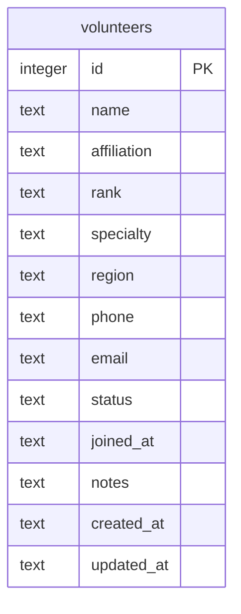

# 03. 데이터 모델

## 현재 스키마

`volunteers` 테이블 하나로 시작합니다.



정의 위치: [`src/db/schema.ts`](../src/db/schema.ts)

## 컬럼

| 컬럼 | DB 타입 | 제약 | 설명 |
| --- | --- | --- | --- |
| `id` | INTEGER | PK, AUTOINCREMENT | 식별자 |
| `name` | TEXT | NOT NULL | 이름. 필수 |
| `affiliation` | TEXT | NOT NULL, 기본 `''` | 소속. 예: `제1보병사단` |
| `rank` | TEXT | NOT NULL, 기본 `''` | 신분/계급. 예: `예비역 대위` |
| `specialty` | TEXT | NOT NULL, 기본 `''` | 전문분야. 예: `전술·리더십` |
| `region` | TEXT | NOT NULL, 기본 `''` | 활동지역. 예: `서울·경기` |
| `phone` | TEXT | NOT NULL, 기본 `''` | 연락처 |
| `email` | TEXT | NOT NULL, 기본 `''` | 이메일 |
| `status` | TEXT | NOT NULL, 기본 `standby` | `active` / `standby` / `inactive` |
| `joined_at` | TEXT | NOT NULL, 기본 `''` | 가입일. `YYYY-MM-DD` |
| `notes` | TEXT | NOT NULL, 기본 `''` | 메모 |
| `created_at` | TEXT | NOT NULL, 기본 `CURRENT_TIMESTAMP` | 생성 시각 |
| `updated_at` | TEXT | NOT NULL, 기본 `CURRENT_TIMESTAMP` | 수정 시각 |

### 활동 상태

| 값 | 라벨 | 색상 토큰 | 의미 |
| --- | --- | --- | --- |
| `active` | 활동중 | `--color-active` | 현재 활동 가능 |
| `standby` | 대기 | `--color-standby` | 활동 대기 |
| `inactive` | 휴면 | `--color-idle` | 당분간 활동 없음 |

상태 라벨과 점 색상은 [`src/lib/status.ts`](../src/lib/status.ts)에서 관리합니다. 라벨을 바꿀 때 UI와 필터 옵션이 같은 정의를 사용하므로 이 파일만 수정하면 됩니다.

## 날짜와 시간

- `joined_at`: 사용자가 입력하는 날짜. `YYYY-MM-DD`
- `created_at`, `updated_at`: 애플리케이션이 ISO 8601 문자열로 기록
- 폼의 가입일 기본값은 **한국 시간(Asia/Seoul) 기준 오늘**
- 표시는 `Intl.DateTimeFormat("ko-KR")`로 `2026. 11. 07.` 형태

날짜만 저장하는 필드는 타임존 영향을 피하려고 `YYYY-MM-DD` 문자열을 그대로 사용합니다.

## 검증 규칙

서버 검증은 [`src/lib/volunteers.ts`](../src/lib/volunteers.ts)의 `parseVolunteerForm`에서 수행합니다.

| 필드 | 규칙 |
| --- | --- |
| `name` | 필수, 공백 제거 후 1~60자 |
| `email` | 선택. 값이 있으면 이메일 형식 |
| `phone` | 선택. 값이 있으면 숫자, `-`, `+`, 괄호, 공백만 4~30자 |
| `joinedAt` | 선택. `YYYY-MM-DD` 형식이고 실제 날짜여야 함 |
| `notes` | 선택. 최대 2,000자 |
| `status` | 세 값 중 하나. 아니면 `standby`로 보정 |

검증 실패 시:

- HTMX 요청: 폼 HTML을 200으로 반환하고 `#form-slot`만 교체
- 일반 요청: 전체 페이지를 200으로 반환

422를 사용하지 않는 이유는 HTMX 기본 동작이 4xx 응답을 swap하지 않기 때문입니다. 자세한 내용은 [07. HTMX 패턴](07_htmx-patterns.md)을 참고하세요.

## 조회와 정렬

목록 조회는 다음 조건을 조합합니다.

- `q`: 이름, 소속, 전문분야, 활동지역에 `LIKE %q%`
- `status`: 정확히 일치
- 정렬: 활동중 → 대기 → 휴면, 같은 상태 안에서는 이름 오름차순
- 별도 페이지네이션 없음: 조건에 맞는 전체 행을 반환

`q`는 앞뒤 공백을 제거하고 최대 80자로 자릅니다. 연락처와 이메일은 검색 대상이 아닙니다.

건수는 목록과 별도 `COUNT(*)` 쿼리로 계산합니다.

## Drizzle 사용

DB 클라이언트:

```ts
const db = getDb(c.env.DB);
```

삽입 예:

```ts
await db.insert(volunteers).values({
  ...values,
  createdAt: now,
  updatedAt: now,
});
```

수정 예:

```ts
await db
  .update(volunteers)
  .set({ ...values, updatedAt: new Date().toISOString() })
  .where(eq(volunteers.id, id));
```

D1에서 `returning()`은 사용하지 않습니다. 삽입 후 별도 조회가 필요하면 `getVolunteer`를 사용하세요.

## 마이그레이션

1. `src/db/schema.ts` 수정
2. `npm run db:generate`
3. `drizzle/`에 SQL과 메타데이터 생성 확인
4. `npm run db:local`로 로컬 적용
5. 배포 시 `npm run db:remote`

현재 마이그레이션:

- `drizzle/0000_demonic_franklin_storm.sql` — `volunteers` 생성

`schema.ts`와 실제 DB가 어긋나면 `npm run db:generate`가 변경분을 생성합니다. 스키마 변경 없이 실행하면 “No schema changes”가 출력됩니다.

## 운영 시 주의

- 현재 인덱스는 없습니다. 데이터가 수천 건 이상으로 늘면 `status`, `name` 인덱스를 검토하세요.
- `LIKE '%...%'` 검색은 인덱스를 타지 않습니다. 규모가 커지면 FTS5 또는 별도 검색을 고려합니다.
- 외래 키를 사용하는 테이블을 추가할 때 D1의 `PRAGMA foreign_keys` 동작을 확인하세요.
- 개인정보(연락처, 이메일)를 저장하므로 접근 제한과 백업 정책이 필요합니다.

## 관련 문서

- 마이그레이션 실행: [02. 로컬 개발](02_local-development.md)
- 배포 시 DB: [09. 배포와 운영](09_deployment-operations.md)
- 테이블 추가 예시: [10. 확장 가이드](10_extension-guide.md)
