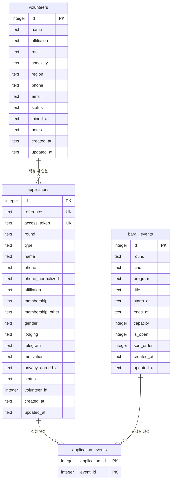

# 03. 데이터 모델

## 전체 구조



정의 위치: [`src/db/schema.ts`](../src/db/schema.ts)

## `volunteers` — 봉사자 명부

| 컬럼 | DB 타입 | 제약 | 설명 |
| --- | --- | --- | --- |
| `id` | INTEGER | PK, AUTOINCREMENT | 식별자 |
| `name` | TEXT | NOT NULL | 이름. 필수 |
| `affiliation` | TEXT | NOT NULL, 기본 `''` | 소속. 예: `제1보병사단` |
| `rank` | TEXT | NOT NULL, 기본 `''` | 신분/계급. 예: `예비역 대위` |
| `specialty` | TEXT | NOT NULL, 기본 `''` | 전문분야 |
| `region` | TEXT | NOT NULL, 기본 `''` | 활동지역 |
| `phone` | TEXT | NOT NULL, 기본 `''` | 연락처 |
| `email` | TEXT | NOT NULL, 기본 `''` | 이메일 |
| `status` | TEXT | NOT NULL, 기본 `standby` | `active` / `standby` / `inactive` |
| `joined_at` | TEXT | NOT NULL, 기본 `''` | 가입일. `YYYY-MM-DD` |
| `notes` | TEXT | NOT NULL, 기본 `''` | 메모 |
| `created_at` | TEXT | NOT NULL, 기본 `CURRENT_TIMESTAMP` | 생성 시각 |
| `updated_at` | TEXT | NOT NULL, 기본 `CURRENT_TIMESTAMP` | 수정 시각 |

### 활동 상태

| 값 | 라벨 | 색상 토큰 | 의미 |
| --- | --- | --- | --- |
| `active` | 활동중 | `--color-active` | 현재 활동 가능 |
| `standby` | 대기 | `--color-standby` | 활동 대기 |
| `inactive` | 휴면 | `--color-idle` | 당분간 활동 없음 |

상태 라벨과 점 색상은 [`src/lib/status.ts`](../src/lib/status.ts)에서 관리합니다.

## `baraji_events` — 모집 일정

| 컬럼 | DB 타입 | 제약 | 설명 |
| --- | --- | --- | --- |
| `id` | INTEGER | PK, AUTOINCREMENT | 식별자 |
| `round` | TEXT | NOT NULL, 기본 `2026-11` | 모집 회차 |
| `kind` | TEXT | NOT NULL | `stay` 숙박형 / `shift` 일일 |
| `program` | TEXT | NOT NULL, 기본 `''` | `서울여행`, `행복학교`, `일일 공양` |
| `title` | TEXT | NOT NULL, 기본 `''` | 표시 제목 |
| `starts_at` | TEXT | NOT NULL | ISO 8601. 한국 시간 오프셋 포함 |
| `ends_at` | TEXT | NOT NULL | ISO 8601 |
| `capacity` | INTEGER | NULL 허용 | 정원. `NULL`이면 제한 없음 |
| `is_open` | INTEGER | NOT NULL, 기본 `true` | 관리자 모집중 토글 |
| `sort_order` | INTEGER | NOT NULL, 기본 `0` | 표시 순서 |
| `created_at` | TEXT | NOT NULL | 생성 시각 |
| `updated_at` | TEXT | NOT NULL | 수정 시각 |

초기 일정은 `drizzle/0002_early_doorman.sql`의 INSERT로 들어갑니다. 정원은 관리자가 `/admin/schedules`에서 입력합니다.

### 일정 판정

- `is_open = false` → 마감
- `starts_at <= 현재` → 마감
- `capacity`가 숫자이고 활성 신청 수가 정원 이상 → 마감
- 활성 신청은 `received`와 `confirmed`만 포함

## `applications` — 신청

| 컬럼 | DB 타입 | 제약 | 설명 |
| --- | --- | --- | --- |
| `id` | INTEGER | PK, AUTOINCREMENT | 식별자 |
| `reference` | TEXT | NOT NULL, UNIQUE | 접수번호. 예: `B26-EUM4GW` |
| `access_token` | TEXT | NOT NULL, UNIQUE | 완료 페이지 접근 토큰 |
| `round` | TEXT | NOT NULL, 기본 `2026-11` | 모집 회차 |
| `type` | TEXT | NOT NULL | `stay` / `shift` |
| `name` | TEXT | NOT NULL | 이름 |
| `phone` | TEXT | NOT NULL | 입력한 연락처 |
| `phone_normalized` | TEXT | NOT NULL | 숫자만 남긴 연락처. 중복 확인 |
| `affiliation` | TEXT | NOT NULL, 기본 `''` | 소속 |
| `membership` | TEXT | NOT NULL, 기본 `general` | `jeonbeop` / `general` / `other` |
| `membership_other` | TEXT | NOT NULL, 기본 `''` | 기타 회원구분 |
| `gender` | TEXT | NOT NULL | `female` / `male` |
| `lodging` | TEXT | NOT NULL, 기본 `yes` | 숙박형의 숙박 여부 |
| `telegram` | TEXT | NOT NULL, 기본 `''` | 텔레그램 ID (선택) |
| `motivation` | TEXT | NOT NULL, 기본 `''` | 신청 동기 |
| `privacy_agreed_at` | TEXT | NOT NULL, 기본 `''` | 개인정보 동의 시각 |
| `status` | TEXT | NOT NULL, 기본 `received` | `received` / `confirmed` / `waitlist` / `cancelled` |
| `volunteer_id` | INTEGER | NULL 허용 | 확정 시 연결된 봉사자 |
| `created_at` | TEXT | NOT NULL | 접수 시각 |
| `updated_at` | TEXT | NOT NULL | 수정 시각 |

### 신청 상태

| 값 | 라벨 | 정원 집계 | 의미 |
| --- | --- | --- | --- |
| `received` | 접수 | 포함 | 신청이 들어온 기본 상태 |
| `confirmed` | 확정 | 포함 | 참여 확정. 명부 자동 등록 |
| `waitlist` | 대기 | 제외 | 정원 초과 또는 운영상 대기 |
| `cancelled` | 취소 | 제외 | 신청 취소 |

상태 라벨과 점 색상은 [`src/lib/applications.ts`](../src/lib/applications.ts)의 `APPLICATION_STATUS_META`에서 관리합니다.

## `application_events` — 신청과 일정 연결

| 컬럼 | DB 타입 | 제약 | 설명 |
| --- | --- | --- | --- |
| `application_id` | INTEGER | PK, NOT NULL | 신청 ID |
| `event_id` | INTEGER | PK, NOT NULL | 일정 ID |

- 숙박형은 한 행, 일일은 선택한 타임 수만큼 행이 생깁니다.
- 복합 기본키로 같은 신청에 같은 일정이 중복 연결되지 않습니다.

## `allowed_emails` — 예외 허용 이메일

| 컬럼 | DB 타입 | 제약 | 설명 |
| --- | --- | --- | --- |
| `id` | INTEGER | PK, AUTOINCREMENT | 식별자 |
| `email` | TEXT | NOT NULL, UNIQUE | 허용할 Google 계정 (소문자) |
| `memo` | TEXT | NOT NULL, 기본 `''` | 등록 사유 |
| `created_by` | TEXT | NOT NULL, 기본 `''` | 등록한 관리자 이메일 |
| `created_at` | TEXT | NOT NULL | 등록 시각 (UTC) |

## 날짜와 시간

- `joined_at`: 사용자가 입력하는 날짜. `YYYY-MM-DD`
- `starts_at`, `ends_at`: ISO 8601 문자열. 예: `2026-11-12T13:30:00+09:00`
- `created_at`, `updated_at`: 애플리케이션이 ISO 8601 문자열로 기록
- 폼의 가입일 기본값은 **한국 시간(Asia/Seoul) 기준 오늘**
- 일정 표시는 모두 `Asia/Seoul` 기준
- 날짜만 저장하는 필드는 타임존 영향을 피하려고 `YYYY-MM-DD` 문자열을 그대로 사용합니다.

## 검증 규칙

### 신청서

서버 검증은 [`src/lib/applications.ts`](../src/lib/applications.ts)의 `parseApplicationForm`, `validateApplicationBasics`, `validateApplication`에서 수행합니다.

| 필드 | 규칙 |
| --- | --- |
| `type` | `stay` 또는 `shift` 필수 |
| `eventIds` | 1개 이상. 숙박형은 정확히 1개. 선택한 방식과 같은 종류의 일정만 사용 |
| `name` | 필수, 2~40자 |
| `phone` | 필수, 숫자 9~11자리, `0`으로 시작 |
| `affiliation` | 필수, 60자 이내 |
| `membership` | 필수. `other`이면 `membershipOther` 필수 |
| `gender` | 필수 |
| `lodging` | 숙박형이면 필수 |
| `telegram` | 선택, 40자 이내, 앞 `@` 제거 |
| `motivation` | 선택, 1,000자 이내 |
| `privacy` | 필수 동의 |

추가 검증:

- 선택한 일정이 존재하고, `is_open`이며, 시작 전이고, 정원이 남아 있어야 함
- 같은 정규화 연락처가 같은 일정에 `received`/`confirmed`/`waitlist`로 이미 신청했으면 거부
- 허니팟 필드 `website`가 채워지면 봇으로 간주

### 봉사자

| 필드 | 규칙 |
| --- | --- |
| `name` | 필수, 공백 제거 후 1~60자 |
| `email` | 선택. 값이 있으면 이메일 형식 |
| `phone` | 선택. 값이 있으면 숫자, `-`, `+`, 괄호, 공백만 4~30자 |
| `joinedAt` | 선택. `YYYY-MM-DD` 형식이고 실제 날짜여야 함 |
| `notes` | 선택. 최대 2,000자 |
| `status` | 세 값 중 하나. 아니면 `standby`로 보정 |

검증 실패 시:

- HTMX 요청: 폼 HTML을 200으로 반환하고 `#form-slot`만 교체
- 일반 요청: 전체 페이지를 200으로 반환

422를 사용하지 않는 이유는 HTMX 기본 동작이 4xx 응답을 swap하지 않기 때문입니다. 자세한 내용은 [07. HTMX 패턴](07_htmx-patterns.md)을 참고하세요.

## 정원 계산

활성 신청 수는 다음 쿼리로 계산합니다.

```sql
SELECT ae.event_id, COUNT(*)
FROM application_events ae
JOIN applications a ON a.id = ae.application_id
WHERE a.status IN ('received', 'confirmed')
GROUP BY ae.event_id;
```

- 취소·대기 신청은 정원에서 제외합니다.
- 관리자가 정원을 현재 신청 수보다 낮게 바꿀 수 있습니다. 이 경우 기존 신청은 유지되고 신규 신청만 막힙니다.
- 신청 저장 직전에 정원을 다시 확인합니다. D1은 쓰기 요청을 직렬화하므로 소규모 모집에서 경쟁 조건 위험이 낮습니다.

## 확정 시 명부 연결

`updateApplicationStatus(..., "confirmed")`가 실행되면:

1. 신청에 `volunteer_id`가 있으면 그대로 사용
2. 없으면 정규화 연락처로 기존 봉사자 검색
3. 있으면 연결하고, 없으면 `volunteers`에 생성
   - 이름, 소속, 연락처
   - 상태 `active`
   - 가입일은 한국 시간 오늘
   - 메모에 `2026-11 바라지 · 일정 요약`
4. `applications.volunteer_id`에 저장

취소해도 봉사자 명부 기록은 자동 삭제하지 않습니다. 필요하면 관리자가 직접 정리합니다.

## 조회와 정렬

- 신청 목록: 최신 접수순(`id DESC`)
- 신청 검색: 이름, 연락처, 소속, 접수번호에 `LIKE %q%`
- 신청 필터: 상태, 참여 방식, 일정
- 봉사자 목록: 활동중 → 대기 → 휴면, 같은 상태에서는 이름 오름차순
- 일정 목록: `sort_order`, `starts_at` 오름차순
- 별도 페이지네이션 없음: 조건에 맞는 전체 행을 반환

## Drizzle 사용

```ts
const db = getDb(c.env.DB);
```

D1에서 `returning()`은 사용하지 않습니다. 삽입 후 별도 조회가 필요하면 고유 토큰이나 연락처로 다시 조회합니다.

## 마이그레이션

1. `src/db/schema.ts` 수정
2. `npm run db:generate`
3. `drizzle/`에 SQL과 메타데이터 생성 확인
4. `npm run db:local`로 로컬 적용
5. 배포 시 `npm run db:remote`

현재 마이그레이션:

- `drizzle/0000_demonic_franklin_storm.sql` — `volunteers` 생성
- `drizzle/0001_perfect_kingpin.sql` — `allowed_emails` 생성
- `drizzle/0002_early_doorman.sql` — `baraji_events`, `applications`, `application_events` 생성 + 2026-11 일정 시드

## 운영 시 주의

- 개인정보(연락처, 성별, 텔레그램 ID)를 저장하므로 접근 제한과 보관 기간을 지켜야 합니다.
- 신청 완료 링크의 `access_token`은 개인 정보 접근 수단입니다. 로그에 남기지 말고 외부에 공유하지 않습니다.
- 데이터가 늘면 `applications(status)`, `applications(phone_normalized)`, `application_events(event_id)` 인덱스를 검토하세요.
- `LIKE '%...%'` 검색은 인덱스를 타지 않습니다. 규모가 커지면 FTS5를 고려합니다.

## 관련 문서

- 마이그레이션 실행: [02. 로컬 개발](02_local-development.md)
- 배포 시 DB: [09. 배포와 운영](09_deployment-operations.md)
- 테이블 추가 예시: [10. 확장 가이드](10_extension-guide.md)
