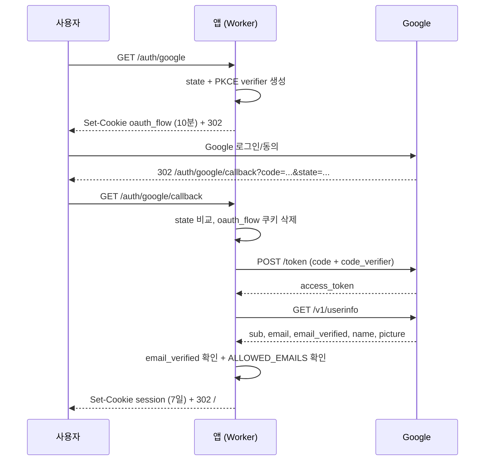

# 04. 인증과 권한

## 방식 요약

- **Google OAuth 2.0 Authorization Code + PKCE**
- 로그인 성공 시 **HMAC 서명 쿠키** 발급
- 허용 이메일 목록(`ALLOWED_EMAILS`)으로 접근 제한
- 세션 저장소나 사용자 테이블 없이 동작
- 현재는 역할 구분 없이 허용된 사용자 모두 동일 권한

## 로그인 흐름



### 1. 로그인 시작

`GET /auth/google`

- `GOOGLE_CLIENT_ID`, `GOOGLE_CLIENT_SECRET`, `SESSION_SECRET`가 모두 없으면 `/login?error=config`
- `state`: 24바이트 랜덤
- PKCE `code_verifier`: 48바이트 랜덤
- `code_challenge`: `BASE64URL(SHA-256(verifier))`, `S256`
- `oauth_flow` 쿠키에 `{ state, verifier }`를 JSON으로 저장 (HttpOnly, 10분)
- Google 인증 URL로 302

요청 파라미터:

```text
scope=openid email profile
prompt=select_account
redirect_uri=<요청 origin>/auth/google/callback
```

### 2. 콜백

`GET /auth/google/callback`

- Google이 `error=access_denied`를 주면 `/login?error=cancelled`
- `code`, `state`, `oauth_flow` 쿠키가 없거나 state가 다르면 `/login?error=state`
- `oauth_flow` 쿠키는 사용 후 즉시 삭제
- 토큰 엔드포인트에 `code_verifier`를 포함해 교환
- UserInfo에서 `sub`, `email`, `email_verified` 확인
- `email_verified === false`이면 거부
- 허용 목록 검사 후 세션 발급

오류 코드:

| `?error=` | 의미 |
| --- | --- |
| `not_allowed` | 허용 목록에 없는 계정 |
| `state` | state/flow 만료 또는 불일치 |
| `cancelled` | 사용자가 동의 취소 |
| `config` | 서버 인증 설정 누락 |
| `oauth` | 토큰 교환/프로필 조회 실패 |

### 3. 세션 발급

[`src/lib/session.ts`](../src/lib/session.ts)의 `createSessionToken`이 담당합니다.

토큰 구조:

```text
base64url(JSON payload) + "." + base64url(HMAC-SHA256(payload, SESSION_SECRET))
```

payload:

```json
{
  "sub": "Google 사용자 ID",
  "email": "user@example.com",
  "name": "홍길동",
  "picture": "https://...",
  "exp": 1799999999
}
```

쿠키 속성:

| 속성 | 값 |
| --- | --- |
| 이름 | `session` |
| HttpOnly | 예 |
| SameSite | `Lax` |
| Path | `/` |
| Secure | HTTPS 요청일 때만 |
| Max-Age | 7일 |

검증 시 HMAC을 `crypto.subtle.verify`로 확인하고, `exp`가 지났거나 payload가 깨졌으면 `null`을 반환합니다. 서명이 다르면 로그인되지 않습니다.

## 접근 제어

### 허용 목록

`ALLOWED_EMAILS`는 쉼표 또는 공백으로 구분합니다.

```dotenv
ALLOWED_EMAILS="admin@example.com, staff@example.com"
ALLOWED_EMAILS="@example.com"
```

- 개별 이메일(`user@example.com`)은 해당 계정만 허용
- `@도메인`(`@example.com`)은 해당 도메인 주소 전체 허용
- 비어 있으면 **모든 로그인 거부** (안전한 기본값)
- `*`가 포함되면 모든 Google 계정 허용
- 대소문자 무시
- `email_verified`가 false인 계정은 목록에 있어도 거부

운영에서는 반드시 명시적인 이메일 목록을 사용하세요.

### 보호된 라우트

[`src/middleware/auth.ts`](../src/middleware/auth.ts)의 `requireAuth`가 적용됩니다.

- 대상: `/` 대시보드, `/volunteers/**`
- 아니면: `/login?error=...` 리다이렉트 (302)
- HTMX 요청이면: `401` + `HX-Redirect: /login`
- 보호된 응답에는 `Cache-Control: no-store`

### 401 동작

HTMX는 401 응답 본문을 swap하지 않습니다. 대신 `HX-Redirect` 헤더를 보고 전체 페이지를 이동합니다. 세션이 만료된 상태에서 표를 조작해도 로그인 화면으로 안내됩니다.

## 개발용 로그인

`ALLOW_DEV_LOGIN="true"`일 때만 `GET /auth/dev`가 열립니다.

- Google OAuth 없이 세션 발급
- 기본 이메일: `dev@example.com`
- 쿼리로 변경 가능: `/auth/dev?email=me@example.com&name=홍길동`
- `SESSION_SECRET`이 없으면 `/login?error=config`
- 플래그가 없으면 404

> 원격 배포 환경에는 절대 설정하지 마세요. 이 플래그는 인증을 우회합니다.

## 로그아웃

`POST /auth/logout`

- `session` 쿠키를 즉시 만료
- `/login`으로 302
- GET 로그아웃 링크는 제공하지 않습니다. 폼의 POST 버튼을 사용합니다.

## 권한 모델의 현재 한계

- 사용자 테이블이 없습니다. Google 프로필은 쿠키에만 존재합니다.
- 역할이 없습니다. 허용된 사용자는 모두 등록·수정·삭제 가능합니다.
- 감사 로그가 없습니다. 누가 무엇을 바꿨는지 기록하지 않습니다.
- 세션 강제 무효화가 어렵습니다. `SESSION_SECRET`을 교체하면 전체 세션이 로그아웃됩니다.

역할 분리, 사용자 관리, 감사 로그가 필요하면 [10. 확장 가이드](10_extension-guide.md)의 `users`/`audit_logs` 설계를 참고하세요.

## 보안 체크리스트

- [ ] 운영 환경에 `ALLOW_DEV_LOGIN`을 설정하지 않았다.
- [ ] `SESSION_SECRET`은 32바이트 이상 랜덤 값이다.
- [ ] `ALLOWED_EMAILS`가 명시되어 있다.
- [ ] Google 콘솔의 승인된 리디렉션 URI가 실제 도메인과 일치한다.
- [ ] HTTPS로만 접속한다.
- [ ] `.dev.vars`를 커밋하지 않았다.
- [ ] Google OAuth 동의 화면이 외부 사용자에게 공개되어 있지 않거나, 필요한 계정만 테스트 사용자로 등록되어 있다.

## 관련 문서

- 로컬에서 Google OAuth 설정: [02. 로컬 개발](02_local-development.md#google-로그인-설정)
- 배포 시 시크릿: [09. 배포와 운영](09_deployment-operations.md)
- 인증 관련 오류: [11. 문제 해결](11_troubleshooting.md)
